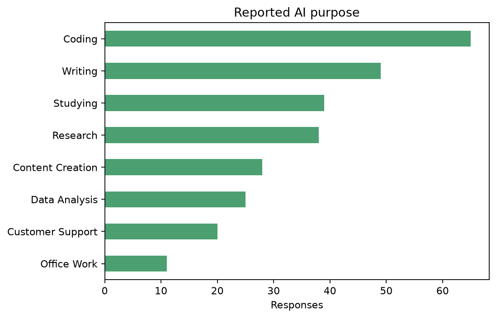

# AI Usage and Impact on Students and Professionals

A small, reproducible Python project exploring how students and professionals report using AI tools and the outcomes they associate with that use. The analysis is descriptive and observational; it does not establish cause and effect.

## What it does

- Cleans supported numeric formats and category-label variations without changing the source CSV.
- Reports missing values and excludes exact duplicate records from analysis.
- Summarizes reported AI purposes, tools, and usage measures.
- Compares selected outcomes between students and professionals and measures one focused association: daily AI use and weekly time saved.
- Produces a small set of useful plots and Excel, Markdown, and PDF reports.

## Dataset and findings

The supplied CSV has **300 rows and 19 columns**. After excluding 12 exact duplicate rows, 288 records remain. Source, sampling method, and redistribution license were not provided; the raw CSV is kept locally and excluded from Git.

In the analyzed records, coding is the most common reported AI purpose (**65 of 275** responses). Median daily AI use is **2 hours**. Reported AI-use hours and weekly time saved have a strong rank association (Spearman ρ = **0.82**, *n* = 271). This association does not show that AI caused respondents to save time. No selected student–professional outcome comparison was statistically significant after adjustment; this does not prove the groups are equivalent.



## Run the project

Use Python 3.10 or later. Open this folder in VS Code and run these commands from its root. On Windows, activation is optional:

```powershell
py -m venv .venv
.\.venv\Scripts\python.exe -m pip install -r requirements.txt
.\.venv\Scripts\python.exe main.py
```

If `py` is unavailable but `python` works, use `python -m venv .venv`. To activate in PowerShell instead, run `.\.venv\Scripts\Activate.ps1`; if script execution is blocked, use the direct interpreter commands above. On macOS/Linux:

```bash
python3 -m venv .venv
source .venv/bin/activate
python -m pip install -r requirements.txt
python main.py
```

The default input is `data/raw/AI_Usage_and_Impact_on_Students_and_Professionals.csv`. Use `python main.py --input path/to/file.csv` for a different CSV. To run tests, use `python -m unittest discover -s tests -v`.

## Outputs

| Output | Location |
|---|---|
| Cleaned data and quality summary | `data/processed/` |
| Plots | `outputs/plots/` |
| Summary tables | `outputs/tables/` |
| Excel workbook | [analysis_report.xlsx](outputs/reports/excel/analysis_report.xlsx) |
| Markdown report | [analysis_report.md](outputs/reports/markdown/analysis_report.md) |
| PDF report | [analysis_report.pdf](outputs/reports/pdf/analysis_report.pdf) |

Plots are selected based on available columns: up to four key numerical distributions, AI-purpose frequencies, a student/professional comparison, and the AI-use/time-saved relationship when those fields exist.

## Project structure

```text
data/raw/                 Original local CSV
data/processed/           Cleaned CSV and quality summary
src/
  config.py               Shared paths and numeric range checks
  data.py                 CSV loading, cleaning, and quality checks
  analysis.py             Descriptive summaries and focused comparisons
  visualization.py        Selected static plots
  report_generator.py     Excel, Markdown, and PDF reports
outputs/plots/            Generated charts
outputs/tables/           Generated analysis tables
outputs/reports/          Reports by format
tests/                    Focused data, analysis, and report checks
main.py                   One-command runner
requirements.txt          Required Python packages
```

## Method and limitations

Blank values are preserved rather than imputed. Numeric fields are parsed when present; values outside configured ranges are reported and treated as missing. Exact duplicate rows are excluded, but potential outliers are retained. Selected group outcomes use Mann–Whitney U tests with Benjamini–Hochberg correction; AI use and time saved are compared using Spearman rank correlation. Results are self-reported, sampling is undocumented, and findings should not be generalized beyond this dataset.
