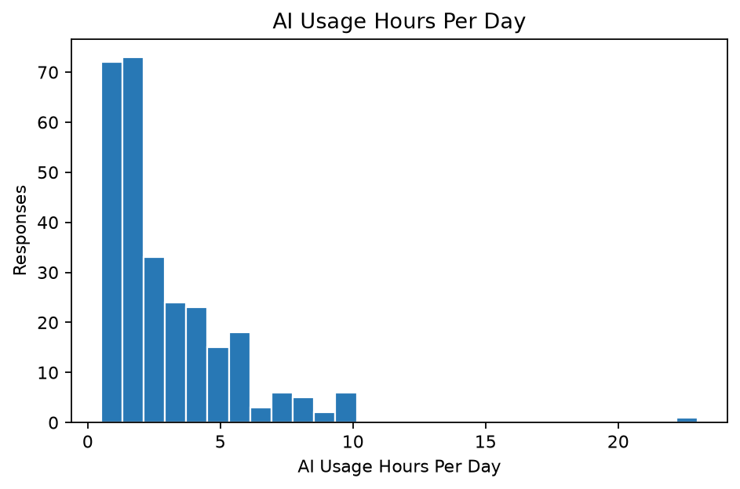
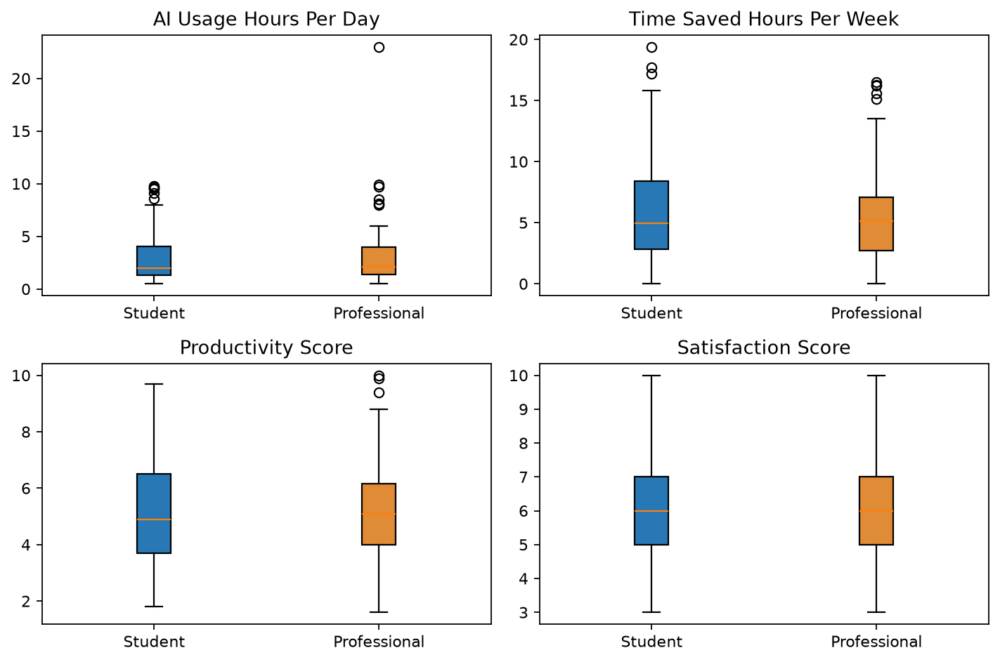
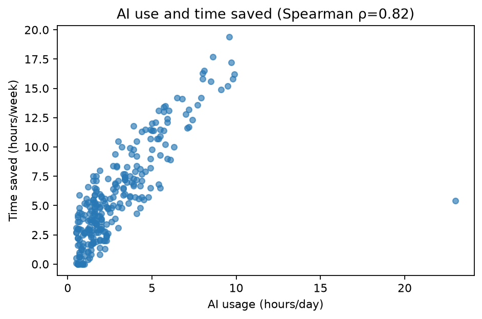

# AI Usage and Impact on Students and Professionals

A descriptive analysis of reported AI use and perceptions. This observational dataset cannot show that AI use caused any reported outcome.

## Dataset and data quality
Source: `AI_Usage_and_Impact_on_Students_and_Professionals.csv`

| measure | value |
| --- | --- |
| Source records | 300 |
| Records analyzed | 288 |
| Columns | 19 |
| Exact duplicate rows excluded | 12 |

Exact duplicate rows were excluded. Text labels and supported numeric formats were standardized. Missing values were not imputed; out-of-range values were flagged and left missing.

| column | missing_count | missing_percent | unique_values | numeric_parse_errors | out_of_range_values |
| --- | --- | --- | --- | --- | --- |
| User_ID | 0 | 0 | 288 | 0 | 0 |
| Age | 23 | 7.99 | 42 | 0 | 0 |
| Gender | 10 | 3.47 | 4 | 0 | 0 |
| Country | 10 | 3.47 | 18 | 0 | 0 |
| User_Type | 0 | 0 | 2 | 0 | 0 |
| Education_Level | 12 | 4.17 | 6 | 0 | 0 |
| Profession | 14 | 4.86 | 126 | 0 | 0 |
| Monthly_Income | 10 | 3.47 | 231 | 0 | 0 |
| AI_Tool | 10 | 3.47 | 8 | 0 | 0 |
| AI_Purpose | 13 | 4.51 | 8 | 0 | 0 |
| AI_Usage_Hours_Per_Day | 7 | 2.43 | 75 | 0 | 0 |
| Tasks_Performed | 17 | 5.9 | 270 | 0 | 0 |
| Monthly_AI_Cost | 12 | 4.17 | 7 | 0 | 0 |
| Productivity_Score | 14 | 4.86 | 73 | 0 | 0 |
| Accuracy_Rating | 14 | 4.86 | 4 | 0 | 0 |
| Satisfaction_Score | 7 | 2.43 | 8 | 0 | 0 |
| Time_Saved_Hours_Per_Week | 10 | 3.47 | 119 | 0 | 0 |
| Work_or_Study_Hours_Per_Day | 9 | 3.12 | 82 | 0 | 0 |
| Would_Recommend | 5 | 1.74 | 3 | 0 | 0 |

## Key findings
- Student make up 52.4% of records with a reported user type. The groups are represented at similar rates.
- Coding is the most common reported AI purpose (65 responses; 23.6% of non-missing responses).
- Daily AI use has a median of 2.0 hours (281 complete responses).
- No selected student–professional outcome comparison remained statistically significant after adjustment; this does not prove the groups are equivalent.
- Daily AI-use hours and reported weekly time saved are associated (Spearman ρ=0.82, n=271); this association does not establish causation.
- Age has the most missing data (8.0%).

## Descriptive results
| variable | count | mean | std | min | 25% | 50% | 75% | max |
| --- | --- | --- | --- | --- | --- | --- | --- | --- |
| Age | 265 | 30.1 | 12.5 | 16 | 22 | 27 | 35 | 97 |
| Monthly_Income | 278 | 2.34e+03 | 1.51e+04 | 0 | 111 | 524 | 1.63e+03 | 2.5e+05 |
| AI_Usage_Hours_Per_Day | 281 | 2.94 | 2.46 | 0.5 | 1.3 | 2 | 4 | 23 |
| Monthly_AI_Cost | 276 | 9.91 | 13.9 | 0 | 0 | 0 | 20 | 100 |
| Productivity_Score | 274 | 5.24 | 1.82 | 1.6 | 3.9 | 5 | 6.5 | 10 |
| Accuracy_Rating | 274 | 3.42 | 0.857 | 2 | 3 | 3.5 | 4 | 5 |
| Satisfaction_Score | 281 | 6.13 | 1.53 | 3 | 5 | 6 | 7 | 10 |
| Time_Saved_Hours_Per_Week | 278 | 5.81 | 4.11 | 0 | 2.73 | 5 | 7.7 | 19.4 |
| Work_or_Study_Hours_Per_Day | 279 | 7.25 | 2 | 2.1 | 6 | 7.2 | 8.4 | 20 |

### Common responses
| variable | category | count | percent |
| --- | --- | --- | --- |
| AI_Purpose | Coding | 65 | 23.6 |
| AI_Purpose | Writing | 49 | 17.8 |
| AI_Purpose | Studying | 39 | 14.2 |
| AI_Purpose | Research | 38 | 13.8 |
| AI_Purpose | Content Creation | 28 | 10.2 |
| AI_Purpose | Data Analysis | 25 | 9.1 |
| AI_Purpose | Customer Support | 20 | 7.3 |
| AI_Purpose | Office Work | 11 | 4 |
| AI_Tool | ChatGPT | 119 | 42.8 |
| AI_Tool | Google Gemini | 39 | 14 |
| AI_Tool | Microsoft Copilot | 33 | 11.9 |
| AI_Tool | Claude | 31 | 11.2 |
| AI_Tool | Perplexity AI | 23 | 8.3 |
| AI_Tool | Grammarly | 14 | 5 |
| AI_Tool | Meta AI | 10 | 3.6 |
| AI_Tool | DeepSeek | 9 | 3.2 |
| Would_Recommend | Yes | 170 | 60.1 |
| Would_Recommend | No | 71 | 25.1 |
| Would_Recommend | Maybe | 42 | 14.8 |

## Student and professional comparison
Outcome comparisons use the Mann–Whitney U test on available responses. Adjusted p-values use the Benjamini–Hochberg method. Results are descriptive, not causal.

| measure | student_n | professional_n | student_median | professional_median | p_value | adjusted_p_value |
| --- | --- | --- | --- | --- | --- | --- |
| AI_Usage_Hours_Per_Day | 146 | 135 | 2 | 2.1 | 0.818 | 0.818 |
| Time_Saved_Hours_Per_Week | 148 | 130 | 4.95 | 5.15 | 0.566 | 0.818 |
| Productivity_Score | 143 | 131 | 4.9 | 5.1 | 0.54 | 0.818 |
| Satisfaction_Score | 150 | 131 | 6 | 6 | 0.68 | 0.818 |

AI purpose by group (percent within each user type):

| AI_Purpose | Professional | Student |
| --- | --- | --- |
| Coding | 28 | 19.6 |
| Content Creation | 11.4 | 9.1 |
| Customer Support | 15.2 | 0 |
| Data Analysis | 13.6 | 4.9 |
| Office Work | 8.3 | 0 |
| Research | 8.3 | 18.9 |
| Studying | 0 | 27.3 |
| Writing | 15.2 | 20.3 |

## Association
Spearman correlation describes a monotonic association and does not establish cause.

| measure_1 | measure_2 | n | spearman_rho | p_value |
| --- | --- | --- | --- | --- |
| AI_Usage_Hours_Per_Day | Time_Saved_Hours_Per_Week | 271 | 0.824 | 2.95e-68 |

## Selected plots

## Limitations
The CSV's source, sampling method, and license are undocumented. Responses are self-reported, missingness may affect results, and findings should not be generalized beyond these records.

## Reproduce
From the project root, install `requirements.txt` and run `python main.py`. Use `python main.py --input path/to/file.csv` for another CSV.
